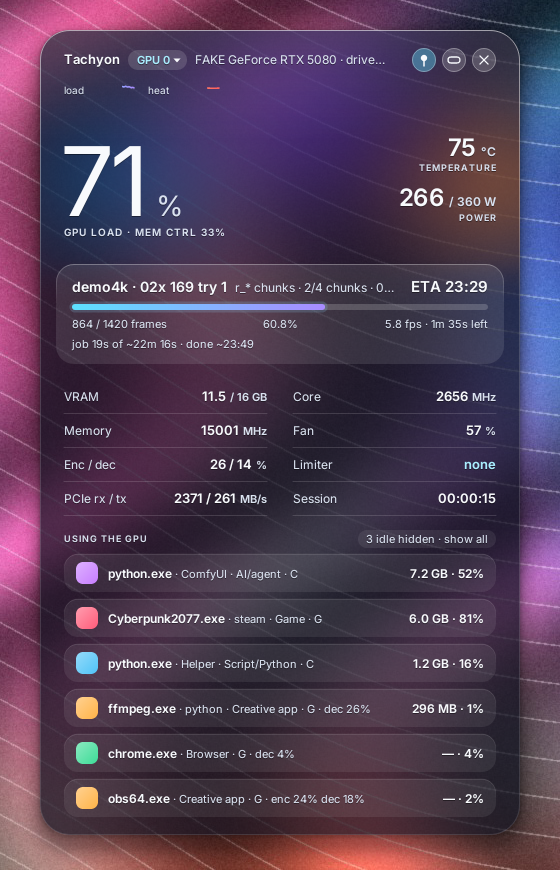
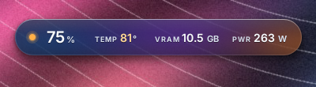
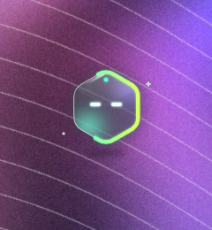

# Tachyon

[](https://github.com/formray/tachyon/actions/workflows/ci.yml)
[](#licences-and-sources)
[](Cargo.toml)
[](#known-limits)
[](https://developer.nvidia.com/management-library-nvml)

<picture>
  <source media="(prefers-color-scheme: dark)" srcset="docs/assets/logo-dark.svg">
  
</picture>

> The lightest real-time GPU monitor. Aurora glass island and a desktop companion for NVIDIA cards.
> It only reads: it never touches clocks, fans, power limits or the network.

By [Formray](https://formray.io).

<p>
  
  
</p>

## Features

- **One portable exe, about 1.4 MB.** No installer, no runtime, no OpenGL,
  no GPU context of its own: it does not wake the GPU it is measuring.
- **Aurora glass:** frosted glass with a soft live colour field. Its hue
  follows the GPU load (blue to violet) and an ember warms up with the
  temperature; it only moves when the values change. Truly borderless:
  per-pixel alpha, rounded shape, soft shadow, and clicks on the empty area
  around it go through to the desktop.
- **Three modes, switched from the right-click menu** (and remembered):
  - **Island:** a capsule at the top of the screen, always on top, with load,
    temperature, VRAM and power. While a render runs the glow fills it like a
    progress bar, with the job, the frames and the ETA.
  - **Companion (Hex):** a small glass hexagon with eyes that sits on your
    desktop. It breathes and blinks now and then, draws a glowing progress
    line round its edge during a render, gets warm (with a little steam) when
    the card is hot and falls asleep after ten quiet minutes. Click it for a
    speech bubble: render progress, load and temperature, the biggest VRAM
    user, four key numbers and *Open panel*.
  - **Panel:** the full window, sized to its content.
- **Everything NVML knows, live:** load, temperature, VRAM, power against the
  limit, core and memory clock, fan, NVENC/NVDEC, PCIe RX/TX, 60 s load and
  heat traces, and the **clock limiters** in plain words (power cap, thermal,
  power brake, …).
- **GPU process attribution:** each process with a category chip (Game,
  Creative app, Script/Python, Browser, AI/agent, System, Other), the program
  that launched it (`python.exe` via `ComfyUI.exe`) and its own SM / ENC / DEC
  % and VRAM. Idle desktop processes are hidden until you click *show all*.
  The categories are rules in a toml file.
- **Optional render tracking:** point it at folders of render logs (ffmpeg,
  tqdm, progress.json, batch and chunk logs) for progress, fps and ETA.
- **Light by design:** one thread; no constant animation timer (Hex arms one
  one-shot timer per frame it actually draws); nothing drawn while hidden or
  behind a fullscreen app; the working set is trimmed after start-up.

## What is here

| Path | What it does |
|---|---|
| [`src/gui.rs`](src/gui.rs) | Island and panel: Win32 layered windows, layout, input, the right-click menu and the mode switch |
| [`src/gui/companion.rs`](src/gui/companion.rs) | Hex and its bubble: windows, hit testing, frame scheduling, dragging |
| [`src/present.rs`](src/present.rs) | The layered presenter: premultiplied BGRA DIB pushed with `UpdateLayeredWindow(ULW_ALPHA)` |
| [`src/aurora.rs`](src/aurora.rs), [`src/glass.rs`](src/glass.rs) | The live colour field and the software glass (tint, sheen, hairline, shadow) |
| [`src/hex.rs`](src/hex.rs), [`src/png.rs`](src/png.rs), [`res/hex/`](res/hex) | Hex: the embedded sprite atlas, a tiny inflate/PNG reader, the animator, the edge glow and the compositor |
| [`src/voice.rs`](src/voice.rs) | What Hex says in its bubble |
| [`src/dw.rs`](src/dw.rs) | DirectWrite text through raw COM, glyph runs cached as coverage textures |
| [`src/theme.rs`](src/theme.rs) | Colours, and the WCAG contrast checks every text colour must pass |
| [`src/nvml.rs`](src/nvml.rs) | NVML loaded at run time; unsupported calls remembered per device |
| [`src/procinfo.rs`](src/procinfo.rs), [`src/monitor.rs`](src/monitor.rs) | Launcher chains, category rules, the process filter, the island rules, the sampler |
| [`src/scan.rs`](src/scan.rs), [`src/parse.rs`](src/parse.rs) | Render log discovery and parsers |
| [`src/config.rs`](src/config.rs) | `tachyon.toml`: defaults, thresholds, saving positions and mode without losing your comments |
| [`tests/`](tests) | Parser, discovery and config tests on anonymised fixtures; a fake `nvml.dll` and wine helpers for screenshots and measurements |

## Usage

Download `tachyon.exe` (or the zip) from the
[releases](https://github.com/formray/tachyon/releases) and double-click it.
The exe is not code-signed, so SmartScreen may ask: *More info*, then
*Run anyway*. Or build it:

```sh
git clone https://github.com/formray/tachyon.git
cd tachyon
# on Windows (MSVC): no icon unless MinGW windres is on PATH
cargo build --release
# from Linux/macOS, as the releases are built:
rustup target add x86_64-pc-windows-gnu      # plus mingw-w64 for the linker and windres
cargo build --release --target x86_64-pc-windows-gnu
```

Click the island to open the panel; the island button (or a double-click on
the top band) goes back. Click Hex for its bubble, drag any of them to move
it. Right-click anywhere for the menu: GPU, pin, show all processes,
**Mode** (island / companion / panel) and quit. Tachyon has no taskbar
button.

On first start `tachyon.toml` is written next to the exe. Leave anything
out and the default is used; positions and the mode are saved on exit
without touching your comments.

```toml
mode = "island"             # "island", "companion" (Hex) or "panel"; unset = from [window] compact
glass = "auto"              # "tint" (works everywhere), "blur" (experimental) or "auto"
poll_ms = 1000              # 250-2000
pcie = true                 # PCIe RX/TX (about 20 ms of NVML wait per tick)
process_refresh_secs = 4
process_cmdline = false     # true = also show command lines (off for privacy)
process_hide = ["dwm.exe", "explorer.exe", "…"]   # hidden unless "show all"
render_roots = []           # folders with render logs; empty = no render tracking

[gpu]
# util_band_low = 77        # optional: cyan inside the band, amber above it
# util_band_high = 82
temp_amber_c = 80.0         # also when Hex gets warm
temp_red_c = 83.0
vram_amber_mb = 14500.0

[window]                    # written for you on exit
always_on_top = true
show_all_processes = false
# island_cx, island_y, x, y, hex_x, hex_y: remembered positions

[[process_rules]]           # first match wins; * wildcards; replaces the built-in list
category = "Game"
color = "#FF5C7A"
names = ["*-win64-shipping.exe"]
parents = ["steam.exe", "epicgameslauncher.exe"]
```

A render machine example is in [`examples/tachyon_render.toml`](examples/tachyon_render.toml).
`glass = true/false` from 4.x files still loads (auto/tint), and a
`rig_monitor.toml` from the earlier name is read when there is no
`tachyon.toml`.

Run it with `TACHYON_DEBUG=1` from a console to see the glass mode, then,
every 10 ticks, paint and poll times, frames drawn, working set, private
bytes and CPU.

## How it works

**Sampling.** A single `WM_TIMER` at `poll_ms` reads NVML synchronously:
utilisation, temperature, memory, power, clocks, fan, encoder and decoder,
one PCIe direction per tick, the clock-event reasons and the process list
with per-process utilisation. A call that answers NOT_SUPPORTED is never
asked again on that device.

**Processes.** A Toolhelp32 snapshot, cached for `process_refresh_secs`,
gives each GPU process its parent chain up to the shell. The first rule
whose `names` match the process or whose `parents` match a launcher sets
the category.

**Drawing.** Every window (island, panel, Hex, bubble) is a
`WS_EX_LAYERED` tool window. Frames are drawn on the CPU into a
premultiplied BGRA DIB (shapes with tiny-skia, text with DirectWrite,
glyphs rasterised once per string and size) and handed to Windows with
`UpdateLayeredWindow(ULW_ALPHA)`, so the transparent pixels really are
transparent. A static layer is kept until its fingerprint changes; each
poll draws only the live values, and nothing is presented when nothing
changed. Hit testing follows the alpha: the shadow and the space around
the shapes let clicks through.

**Hex** is a sprite atlas (three 8-bit masks for 1x, 1.5x and 2x, about
140 KB) embedded in the exe and decoded by a small built-in PNG reader for
the current DPI only. A script of states (idle, render, hot, sleepy) with
hysteresis picks the frames; the progress edge is a distance-field stroke
with an analytic glow, cached per 0.1 % of progress. Each drawn frame arms
one one-shot timer for its hold (0.33 s to 2 s; 12 fps only for blinks and
transitions), and Hex pauses while it is hidden or a fullscreen app is in
front of its monitor.

## Measured

**Pending: real numbers on an RTX 5080 (Windows 11) are being collected
and will replace this note.** Until then, every figure below comes from
**wine 10 on Linux with a fake `nvml.dll`** ([`tests/fake_nvml_v4.c`](tests/fake_nvml_v4.c)),
Xvfb and the picom compositor, the same fake processes for every run,
30 s after a 22 s warm-up ([`tests/measure.sh`](tests/measure.sh)):

| Wine 10, fake driver | App CPU (one core) | Resident memory |
|---|---|---|
| Island, idle | 0.30 % | 33 MB |
| Companion (Hex), idle: breathing and blinks | 0.27 % | 34 MB |
| Companion, hot: 3 fps loop | 0.53 % | 34 MB |
| Companion, rendering: progress edge | 0.43 % | 35 MB |
| Island, rendering | 0.60 % | 33 MB |
| Panel | 1.20 % | 42 MB |
| *4.x for comparison: window / island* | *1.33 % / 0.20 %* | *40 / 34 MB* |

Exe: 1,423,872 bytes. Most of the resident memory is wine itself, and wine
neither trims the working set nor reports private bytes, so these figures
say how the modes and versions compare, not what Windows will show.

## Screenshots

Taken under wine with the fake driver and a procedurally generated
wallpaper ([`tests/make_wallpaper.py`](tests/make_wallpaper.py)), so every
name and value is synthetic. The X root was captured after picom blended
the layered windows, so what you see is the real per-pixel alpha.

| | |
|---|---|
|  |  |
|  |  |

## Known limits

- **Not yet run on real Windows.** Everything above was built and checked
  under wine; the Windows 10/11 checks are still to come.
- **NVIDIA only**, Windows 10 1607+ or 11, 64-bit.
- **No real backdrop blur:** the glass is a tinted fallback.
  `glass = "blur"` is experimental (it may show jagged edges or a blurred
  rectangle), which is why `auto` stays on the tint.
- **Bubble:** Esc does not close it (it never takes keyboard focus): click
  Hex or the bubble, or wait 8 s. It opens with a fade and a slide, not a
  scale.
- The **fullscreen pause** has not been tested on Windows.
- **Click-through:** halo pixels with alpha of 96/255 or more take clicks;
  the shadow passes them through (`HTTRANSPARENT`).
- **No tray icon and no taskbar button:** use the island, Hex or the
  right-click menu.
- **Tabular digits** rely on Segoe UI; with other fonts numbers may shift
  slightly.
- The **hot state** redraws at 3 fps for as long as the card stays at or
  above `temp_amber_c`.
- The **panel** sizes itself to its content; it cannot be resized.
- **Per-process VRAM:** under WDDM the driver often reports none ("—").
  Per-process SM/ENC/DEC needs driver support.

## Licences and sources

- Tachyon: MIT OR Apache-2.0 ([LICENSE-MIT](LICENSE-MIT),
  [LICENSE-APACHE](LICENSE-APACHE)), © 2026 Formray.
- Dependencies (all MIT and/or Apache-2.0, or BSD-3-Clause for tiny-skia):
  windows-sys, tiny-skia, libloading, serde, serde_json, toml, toml_edit, chrono.
- NVML (`nvml.dll`) ships with the NVIDIA driver; it is loaded at run time
  and not redistributed.
- No code from GPL or AGPL projects.
- The logo, the Hex character and its atlas are drawn for this repository;
  the logo lettering is set in Inter (SIL Open Font License) and turned
  into outlines.

## Contributing

Real Windows numbers are the most useful contribution right now. See
[CONTRIBUTING](CONTRIBUTING.md): read-only always, light first, a test or
a screenshot with every change.

---

<sub>Made by [Formray](https://formray.io). Technology, thoughtfully.</sub>
