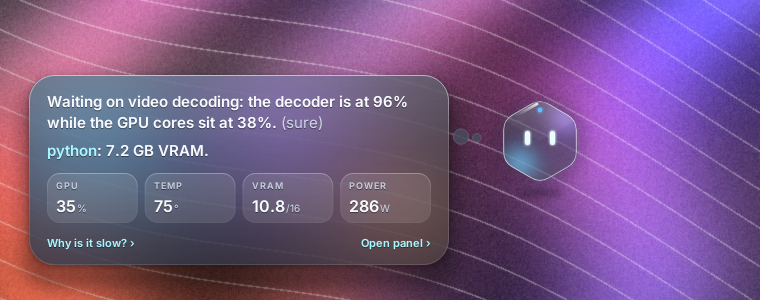
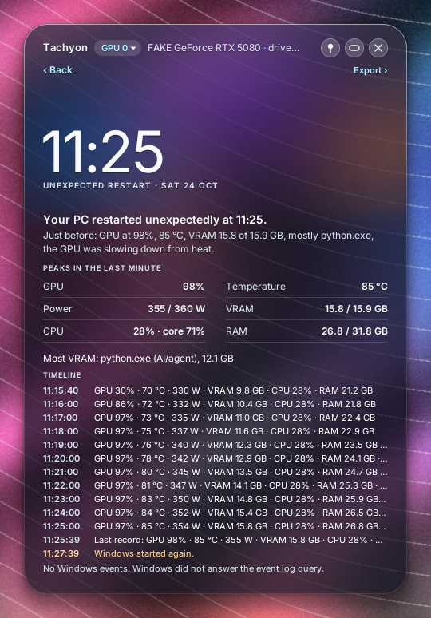
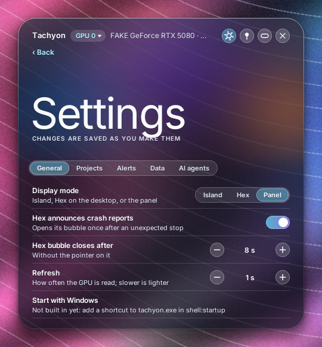
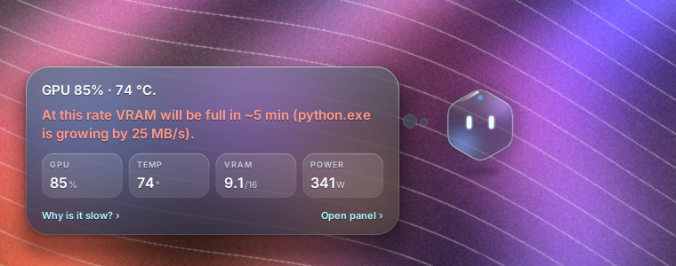
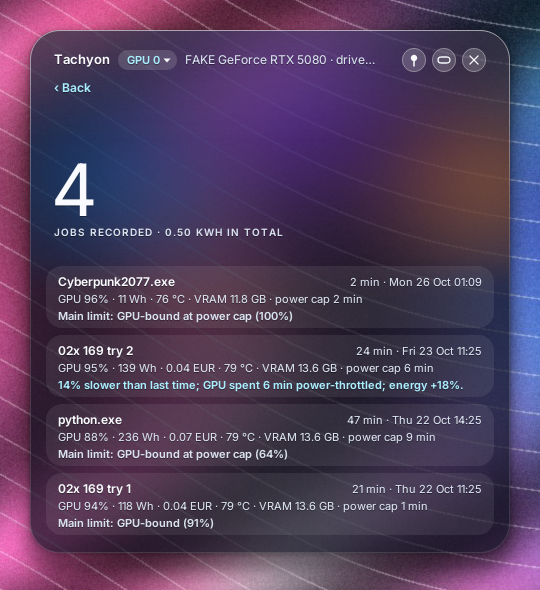
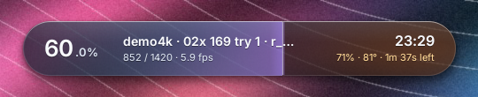
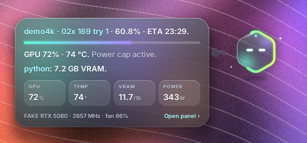
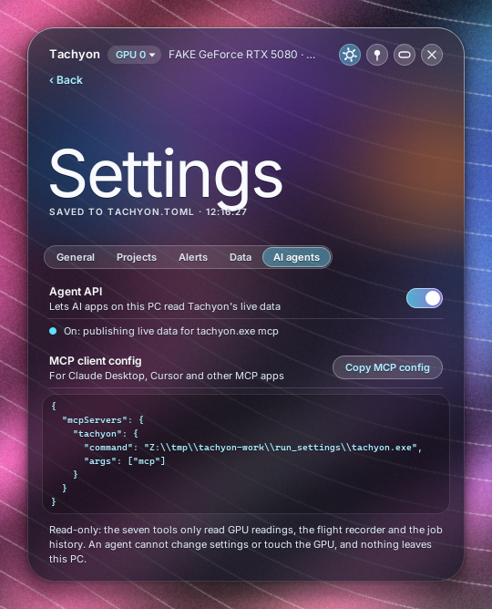

# Tachyon

[](https://github.com/formray/tachyon/actions/workflows/ci.yml)
[](#licences-and-sources)
[](Cargo.toml)
[](#known-limits)
[](https://developer.nvidia.com/management-library-nvml)

<picture>
  <source media="(prefers-color-scheme: dark)" srcset="docs/assets/logo-dark.svg">
  
</picture>

> The lightest real-time GPU monitor for NVIDIA cards, and the one that explains itself:
> what is holding your work back, when VRAM will run out, why the PC went down, and how this
> render compares with the last one. It only reads: it never touches clocks, fans, power
> limits or the network.

By [Formray](https://formray.io).

<p>
  
  
</p>

Tachyon 1.0 is the first release. The 5.0 to 5.1.1 builds were previews before 1.0; see
the [changelog](CHANGELOG.md#previews).

## Features

New in 1.0, all worked out on the PC from the readings Tachyon already takes (no extra
polling, no cloud, no AI model):

- **Flight recorder.** The last 15 minutes of readings (load, temperature, power, VRAM,
  clocks, limiters, top processes) go into two small fixed-size files on disk, about
  170 KB each. If Windows restarts or Tachyon is killed, the next start shows a **crash
  report**: what happened in the last minutes, the peaks, which process held the most VRAM
  and the matching Windows events (Kernel-Power, bug checks, WHEA hardware errors, NVIDIA
  driver resets), in plain words. Hex mentions it once, with *Open report*. *Export flight
  recorder* in the menu writes CSV and JSON.
- **"Why is it slow?"** A one-sentence answer to what is holding the work back: the GPU
  itself, the power cap, heat, the video decoder or encoder, one CPU thread, all CPU cores,
  VRAM or PCIe, with *sure*, *likely* or *possibly* and the readings behind it. It only
  changes after the new answer has held for a few seconds, so it does not flicker. In the
  panel, and in Hex's bubble.
- **VRAM forecast.** A robust trend of video memory (median slope, so one spike does not
  count) for the card and each process. It warns only when the trend is steady and the card
  would be full within 15 minutes ("At this rate VRAM will be full in ~6 min (python.exe is
  growing by 25 MB/s)"), and points out background apps holding VRAM without using the GPU.
- **Job history.** Each finished render job, or each GPU-busy stretch of a minute or more,
  is saved as one line: duration, average and peak load, fps, energy in Wh (from the
  driver's energy counter), peak VRAM and temperature, time spent throttled and the main
  limit. The next run of the same job is compared with it ("14% slower than last time; GPU
  spent 6 min power-throttled"). Set `price_per_kwh` to see what each job cost.
- **For AI agents: `tachyon.exe mcp`.** A local [MCP](https://modelcontextprotocol.io)
  server with seven read-only tools, so an assistant like Claude Desktop or Cursor can ask
  what the GPU is doing and why. Off until you turn it on in Settings (or set
  `agent_api = true`); it runs on pipes, not the network.
- **Settings page.** Right-click the island, Hex or the panel and pick *Settings…*, or
  use the gear in the panel. Mode, refresh rate, project folders, alert thresholds, the
  flight recorder, the job history, the energy price and the agent API, with a *Copy MCP
  config* button. Changes are saved as you make them and apply at once; only the flight
  recorder needs a restart.

Carried over from the previews:

- **One portable exe, about 1.8 MB.** No installer, no runtime, no OpenGL,
  no GPU context of its own: it does not wake the GPU it is measuring.
- **Aurora glass:** frosted glass with a soft live colour field. Its hue
  follows the GPU load (blue to violet) and an ember warms up with the
  temperature; it only moves when the values change. Truly borderless:
  per-pixel alpha, rounded shape, soft shadow, and clicks on the empty area
  around it go through to the desktop.
- **Three modes, switched from the right-click menu** (and remembered):
  - **Island:** a capsule at the top of the screen, always on top, with load,
    temperature, VRAM and power. While a render runs the glow fills it like a
    progress bar, with the job, the frames and the ETA.
  - **Companion (Hex):** a small glass hexagon with eyes that sits on your
    desktop. It breathes and blinks now and then, draws a glowing progress
    line round its edge during a render, gets warm (with a little steam) when
    the card is hot and falls asleep after ten quiet minutes. Click it for a
    speech bubble: render progress, load and temperature, the biggest VRAM
    user, four key numbers and *Open panel*.
  - **Panel:** the full window, sized to its content.
- **Everything NVML knows, live:** load, temperature, VRAM, power against the
  limit, core and memory clock, fan, NVENC/NVDEC, PCIe RX/TX, 60 s load and
  heat traces, and the **clock limiters** in plain words (power cap, thermal,
  power brake, …).
- **GPU process attribution:** each process with a category chip (Game,
  Creative app, Script/Python, Browser, AI/agent, System, Other), the program
  that launched it (`python.exe` via `ComfyUI.exe`) and its own SM / ENC / DEC
  % and VRAM. Idle desktop processes are hidden until you click *show all*.
  The categories are rules in a toml file.
- **Optional render tracking:** point it at folders of render logs (ffmpeg,
  tqdm, progress.json, batch and chunk logs) for progress, fps and ETA.
- **Light by design:** one thread; no constant animation timer (Hex arms one
  one-shot timer per frame it actually draws); nothing drawn while hidden or
  behind a fullscreen app; the working set is trimmed after start-up. The 1.0
  analysis runs on the samples already taken, and the recorder writes every
  5 s and flushes every 30 s.

## What is here

| Path | What it does |
|---|---|
| [`src/gui.rs`](src/gui.rs) | Island and panel: Win32 layered windows, layout, input, the right-click menu and the mode switch |
| [`src/gui/companion.rs`](src/gui/companion.rs) | Hex and its bubble: windows, hit testing, frame scheduling, dragging |
| [`src/present.rs`](src/present.rs) | The layered presenter: premultiplied BGRA DIB pushed with `UpdateLayeredWindow(ULW_ALPHA)` |
| [`src/aurora.rs`](src/aurora.rs), [`src/glass.rs`](src/glass.rs) | The live colour field and the software glass (tint, sheen, hairline, shadow) |
| [`src/hex.rs`](src/hex.rs), [`src/png.rs`](src/png.rs), [`res/hex/`](res/hex) | Hex: the embedded sprite atlas, a tiny inflate/PNG reader, the animator, the edge glow and the compositor |
| [`src/gui/views.rs`](src/gui/views.rs) | The insights block, and the Crash report and History views |
| [`src/voice.rs`](src/voice.rs) | What Hex says in its bubble |
| [`src/explain.rs`](src/explain.rs) | "Why is it slow?": rules with hysteresis over the last 10 s of samples |
| [`src/forecast.rs`](src/forecast.rs) | VRAM trend (Theil-Sen slope) per card and process, idle VRAM hogs |
| [`src/recorder.rs`](src/recorder.rs), [`src/report.rs`](src/report.rs), [`src/events.rs`](src/events.rs) | Flight recorder ring files, the crash report and its export, Windows events through `EvtQuery` |
| [`src/history.rs`](src/history.rs) | Job detection, energy, `jobs.jsonl` and the comparison with the last run |
| [`src/insight.rs`](src/insight.rs) | Ties the four together, once per tick, on the samples the monitor already has |
| [`src/mcp.rs`](src/mcp.rs), [`src/agent.rs`](src/agent.rs) | `tachyon.exe mcp` and the read-only status Tachyon publishes in shared memory |
| [`src/dw.rs`](src/dw.rs) | DirectWrite text through raw COM, glyph runs cached as coverage textures |
| [`src/theme.rs`](src/theme.rs) | Colours, and the WCAG contrast checks every text colour must pass |
| [`src/nvml.rs`](src/nvml.rs) | NVML loaded at run time; unsupported calls remembered per device |
| [`src/procinfo.rs`](src/procinfo.rs), [`src/monitor.rs`](src/monitor.rs) | Launcher chains, category rules, the process filter, the island rules, the sampler |
| [`src/scan.rs`](src/scan.rs), [`src/parse.rs`](src/parse.rs) | Render log discovery and parsers |
| [`src/config.rs`](src/config.rs) | `tachyon.toml`: defaults, thresholds, saving positions and mode without losing your comments |
| [`tests/`](tests) | Parser, discovery, config and synthetic-scenario tests; a fake `nvml.dll`, a scripted MCP client and wine helpers for screenshots and measurements |

## Usage

Download `tachyon.exe` (or the zip) from the
[releases](https://github.com/formray/tachyon/releases) and double-click it.
The exe is not code-signed, so SmartScreen may ask: *More info*, then
*Run anyway*. Or build it:

```sh
git clone https://github.com/formray/tachyon.git
cd tachyon
# on Windows (MSVC): no icon unless MinGW windres is on PATH
cargo build --release
# from Linux/macOS, as the releases are built:
rustup target add x86_64-pc-windows-gnu      # plus mingw-w64 for the linker and windres
cargo build --release --target x86_64-pc-windows-gnu
```

Click the island to open the panel; the island button (or a double-click on
the top band) goes back. Click Hex for its bubble, drag any of them to move
it. Right-click anywhere for the menu: GPU, pin, show all processes,
**Mode** (island / companion / panel), **Crash report**, **Job history**,
**Export flight recorder** and quit. Tachyon has no taskbar button.

In the panel, *Why? ›* next to the bottleneck explains it, *Open report ›*
opens the crash report and *History ›* the job list. In Hex's bubble, *Why
is it slow? ›* swaps the bubble for the answer.

### Settings



*Settings…* in the right-click menu (island, Hex or panel), or the gear at the
top of the panel. Five tabs:

| Tab | What you can change |
|---|---|
| General | Display mode (island, Hex, panel); whether Hex announces crash reports; how long Hex's bubble stays open (5–30 s or until clicked); refresh rate (0.25–2 s) |
| Projects | Render folders to watch (up to 12): add with a folder picker, remove with × |
| Alerts | Temperature amber and red; VRAM amber and red (GB); how far ahead the VRAM forecast warns (5–60 min, or off) |
| Data | Flight recorder on/off and how many minutes it keeps; job history on/off; energy price and currency |
| AI agents | Agent API on/off with its live state, *Copy MCP config*, and what agents can and cannot do |

Use the − and + buttons or the mouse wheel over a value. Each change is
checked against those limits, saved straight away and applied while Tachyon
runs; the flight recorder is the one setting that says *restart to apply*.
The file is written to a temporary file first and then renamed, so a crash
mid-save cannot leave half a file; the first change of each visit keeps the
previous file as `tachyon.toml.bak`. Comments, unknown keys and anything the
page does not show are kept. The page only edits `tachyon.toml`; it changes
nothing in Windows. There is no *Start with Windows* switch yet: put a
shortcut to `tachyon.exe` in `shell:startup`.

On first start `tachyon.toml` is written next to the exe. Leave anything
out and the default is used; positions and the mode are saved on exit
without touching your comments.

```toml
mode = "island"             # "island", "companion" (Hex) or "panel"; unset = from [window] compact
glass = "auto"              # "tint" (works everywhere), "blur" (experimental) or "auto"
poll_ms = 1000              # 250-2000
pcie = true                 # PCIe RX/TX (about 20 ms of NVML wait per tick)
process_refresh_secs = 4
process_cmdline = false     # true = also show command lines (off for privacy)
process_hide = ["dwm.exe", "explorer.exe", "…"]   # hidden unless "show all"
render_roots = []           # folders with render logs; empty = no render tracking
blackbox = true             # flight recorder (about 340 KB on disk in total)
blackbox_minutes = 15       # 1-60
history = true              # job history
# price_per_kwh = 0.30      # optional: show the energy cost of each job
currency = "EUR"
agent_api = false           # true = let `tachyon.exe mcp` answer AI agents
hex_announce = true         # Hex opens its bubble once after an unexpected stop
bubble_close_secs = 8       # Hex's bubble closes after this; 0 = only when clicked
vram_forecast_minutes = 15  # warn when VRAM would be full this soon; 0 = off

[gpu]
# util_band_low = 77        # optional: cyan inside the band, amber above it
# util_band_high = 82
temp_amber_c = 80.0         # also when Hex gets warm
temp_red_c = 83.0
vram_amber_mb = 14500.0
vram_red_mb = 15600.0

[window]                    # written for you on exit
always_on_top = true
show_all_processes = false
# island_cx, island_y, x, y, hex_x, hex_y: remembered positions

[[process_rules]]           # first match wins; * wildcards; replaces the built-in list
category = "Game"
color = "#FF5C7A"
names = ["*-win64-shipping.exe"]
parents = ["steam.exe", "epicgameslauncher.exe"]
```

A render machine example is in [`examples/tachyon_render.toml`](examples/tachyon_render.toml).
`glass = true/false` from 4.x files still loads (auto/tint), and a
`rig_monitor.toml` from the earlier name is read when there is no
`tachyon.toml`.

### Your data

The flight recorder, the history and exports live in `%LOCALAPPDATA%\Tachyon`
(`blackbox\`, `history\jobs.jsonl`, `exports\`), and nowhere else. Nothing
leaves the PC: Tachyon has no network code. The recorder keeps process names
(up to 24 characters), never paths or command lines; the history keeps job
names as they appear in your render logs. Turn either off with `blackbox =
false` or `history = false`, and delete the folder to remove everything.

### AI agents (MCP)

Open *Settings… → AI agents* and turn on *Agent API*; it starts at once.
*Copy MCP config* puts the client entry on the clipboard with the full path
of this `tachyon.exe`. Paste it into your MCP client: for Claude Desktop
`claude_desktop_config.json`, for Cursor `.cursor/mcp.json`. Without the page,
set `agent_api = true` and restart Tachyon. The entry looks like this:

```json
{
  "mcpServers": {
    "tachyon": { "command": "C:\\Tools\\Tachyon\\tachyon.exe", "args": ["mcp"] }
  }
}
```

The client starts `tachyon.exe mcp` and talks to it over stdin and stdout.
Tools: `get_status`, `get_bottleneck`, `get_vram_forecast`, `get_processes`,
`get_blackbox`, `get_history`, `compare_last_run`; all are read-only. With
Tachyon running, they read the status it publishes every two seconds; without
it, `tachyon mcp` takes its own short reading.

Run it with `TACHYON_DEBUG=1` from a console to see the glass mode, then,
every 10 ticks, paint and poll times, frames drawn, working set, private
bytes and CPU.

## How it works

**Sampling.** A single `WM_TIMER` at `poll_ms` reads NVML synchronously:
utilisation, temperature, memory, power, clocks, fan, encoder and decoder,
one PCIe direction per tick, the clock-event reasons and the process list
with per-process utilisation. A call that answers NOT_SUPPORTED is never
asked again on that device.

**Processes.** A Toolhelp32 snapshot, cached for `process_refresh_secs`,
gives each GPU process its parent chain up to the shell. The first rule
whose `names` match the process or whose `parents` match a launcher sets
the category.

**Drawing.** Every window (island, panel, Hex, bubble) is a
`WS_EX_LAYERED` tool window. Frames are drawn on the CPU into a
premultiplied BGRA DIB (shapes with tiny-skia, text with DirectWrite,
glyphs rasterised once per string and size) and handed to Windows with
`UpdateLayeredWindow(ULW_ALPHA)`, so the transparent pixels really are
transparent. A static layer is kept until its fingerprint changes; each
poll draws only the live values, and nothing is presented when nothing
changed. Hit testing follows the alpha: the shadow and the space around
the shapes let clicks through.

**Hex** is a sprite atlas (three 8-bit masks for 1x, 1.5x and 2x, about
140 KB) embedded in the exe and decoded by a small built-in PNG reader for
the current DPI only. A script of states (idle, render, hot, sleepy) with
hysteresis picks the frames; the progress edge is a distance-field stroke
with an analytic glow, cached per 0.1 % of progress. Each drawn frame arms
one one-shot timer for its hold (0.33 s to 2 s; 12 fps only for blinks and
transitions), and Hex pauses while it is hidden or a fullscreen app is in
front of its monitor.

**Insights.** Each tick hands the sample just taken to the insight engine;
nothing is polled for it. The bottleneck rules look at the last 10 s and a
new answer must win four evaluations in a row. The VRAM trend is a Theil-Sen
slope over two minutes. The recorder packs each second into a 192-byte
checksummed record, in two preallocated ring files that take turns per
session; `session.json` says whether the last session ended cleanly. On the
next start, an unclean end plus the boot time (`GetTickCount64`) tells a
restart from a killed app, and `EvtQuery` fetches the System events of that
window. Jobs are accumulated as sums and peaks, so a long render costs a few
hundred bytes. One instance records at a time (`tachyon.lock`).

## Measured

### Windows 11, RTX 5080

One PC: Windows 11 Pro (build 26300), GeForce RTX 5080 16 GB, driver 617.42,
Ryzen 9 9950X (32 threads), 64 GB RAM. Tachyon in Hex (companion) mode,
measured from outside with `Get-Process` (CPU time over the window,
working set and private bytes) while a GPU video render ran (87 s and
143 s, the GPU at 72–84 % and about 220–260 W) and again with the GPU idle.
The render rows are from the 1.0 build just before the Settings page, the
idle and MCP rows from this release.

| Windows 11, RTX 5080 | CPU (all 32 threads) | CPU (one core) | Working set | Private bytes |
|---|---|---|---|---|
| Hex, GPU rendering (5 s samples, 158 in all) | 0.05 % (peak 0.17 %) | about 1.6 % | 32 MB (peak 34) | 38 MB |
| Hex, idle (60 s, agent API on) | 0.025 % | 0.8 % | 25 MB | 33 MB |
| `tachyon.exe mcp`, between requests | 0 % | 0 % | 9 MB | 1.7 MB |

The two render jobs were picked up from their logs and saved in the job
history, and the panel's VRAM figure matched `nvidia-smi` (1252 vs 1254 MiB
with 326 MiB reserved by the driver). An MCP client on the same PC got its
`initialize` answer 9 ms after starting `tachyon.exe mcp`; with Tachyon
running, each tool answered in 0.05–0.4 ms (median; at most 8.5 ms for the
first `get_blackbox`, which reads the recorder files), and temperature and
power matched `nvidia-smi` (35 °C, 29.6 vs 29.0 W).

### Wine on Linux

These figures come from
**wine 10 on Linux with a fake `nvml.dll`** ([`tests/fake_nvml_v4.c`](tests/fake_nvml_v4.c)),
Xvfb and the picom compositor, the same fake processes for every run,
30 s after a 22 s warm-up ([`tests/measure.sh`](tests/measure.sh)). The
preview 5.1.1 was measured in the same session, alternating with 1.0. 1.0
includes the flight recorder, the job history and the insights; the agent
API was off.

| Wine 10, fake driver | 1.0 CPU (one core) | 1.0 memory | 5.1.1 CPU | 5.1.1 memory |
|---|---|---|---|---|
| Island, idle | 0.33 % | 34 MB | 0.33 % | 33 MB |
| Companion (Hex), idle | 0.40 % | 34 MB | 0.27 % | 34 MB |
| Panel, idle | 1.57 % | 45 MB | 1.13 % | 42 MB |
| Island, rendering | 0.53 % | 34 MB | 0.53 % | 33 MB |
| Companion, rendering | 0.43 % | 35 MB | 0.40 % | 34 MB |
| Panel, rendering | 1.47 % | 46 MB | 1.27 % | 43 MB |
| Companion, hot (3 fps loop) | 0.57 % | 34 MB | | |

Exe: 1,803,776 bytes (5.1.1: 1,423,872). Single 30 s windows vary by
about ±0.1 percentage points between runs. The panel costs a little more
than in 5.1.1 because it is taller and shows the insights; island and Hex
are about where they were. Most of the resident memory is wine itself, and
wine neither trims the working set nor reports private bytes, so these
figures say how the modes and versions compare, not what Windows will show.

The Settings page costs nothing while it is closed: it holds no state and
no timer then. Measured the same way against the 1.0 build without it,
alternating, panel idle came out at 1.50–2.23 % vs 1.37–1.93 %, island
idle 0.40 % vs 0.40 %, Hex idle 0.40 % vs 0.43 %, with 1–2 MB more resident
memory (a slightly larger exe: 1,846,272 bytes).

## Screenshots

Taken under wine with the fake driver and a procedurally generated
wallpaper ([`tests/make_wallpaper.py`](tests/make_wallpaper.py)), so every
name and value is synthetic. The X root was captured after picom blended
the layered windows, so what you see is the real per-pixel alpha.

The crash report comes from a seeded session (`tests/demo_data.rs`); the
history shows two seeded runs of a demo job and one GPU session recorded live
under wine.

| | |
|---|---|
|  |  |
|  |  |
|  |  |
|  |  |

## Known limits

- **Checked on one Windows 11 PC** (RTX 5080) for live readings, job detection,
  the history and the MCP server; Windows 10 and other cards are untested.
  The crash report after a real restart, its Windows events and the restart
  detection are still only tested with synthetic data (wine does not answer
  event log queries).
- **Crash report:** it can say *when* and *what was running*, not prove the
  cause. A clean shutdown is not a crash; a power cut during the last 30 s may
  lose those seconds.
- **Bottleneck and forecast** are rules over driver readings, not a profiler:
  *possibly* means a guess. Per-process VRAM is often missing under WDDM, and
  then the forecast is for the card only.
- **NVIDIA only**, Windows 10 1607+ or 11, 64-bit.
- **No real backdrop blur:** the glass is a tinted fallback.
  `glass = "blur"` is experimental (it may show jagged edges or a blurred
  rectangle), which is why `auto` stays on the tint.
- **Bubble:** Esc does not close it (it never takes keyboard focus): click
  Hex or the bubble, or wait 8 s (change it in Settings). It opens with a fade and a slide, not a
  scale.
- The **fullscreen pause** has not been tested on Windows.
- **Click-through:** halo pixels with alpha of 96/255 or more take clicks;
  the shadow passes them through (`HTTRANSPARENT`).
- **No tray icon and no taskbar button:** use the island, Hex or the
  right-click menu.
- **Tabular digits** rely on Segoe UI; with other fonts numbers may shift
  slightly.
- The **hot state** redraws at 3 fps for as long as the card stays at or
  above `temp_amber_c`.
- The **panel** sizes itself to its content; it cannot be resized.
- **VRAM figures** are MiB (1024 × 1024 bytes), labelled MB, and "used" is the same
  number `nvidia-smi` shows: it leaves out the memory the driver reserves for itself
  (about 300 MiB on a 16 GB card). Drivers without `nvmlDeviceGetMemoryInfo_v2` only
  report used + reserved, so there Tachyon reads that much higher.
- **Per-process VRAM:** under WDDM the driver often reports none ("—").
  Per-process SM/ENC/DEC needs driver support.

## Licences and sources

- Tachyon: MIT OR Apache-2.0 ([LICENSE-MIT](LICENSE-MIT),
  [LICENSE-APACHE](LICENSE-APACHE)), © 2026 Formray.
- Dependencies (all MIT and/or Apache-2.0, or BSD-3-Clause for tiny-skia):
  windows-sys, tiny-skia, libloading, serde, serde_json, toml, toml_edit, chrono.
- NVML (`nvml.dll`) ships with the NVIDIA driver; it is loaded at run time
  and not redistributed.
- No code from GPL or AGPL projects.
- The logo, the Hex character and its atlas are drawn for this repository;
  the logo lettering is set in Inter (SIL Open Font License) and turned
  into outlines.

## Contributing

Real Windows numbers, and crash reports from real crashes, are the most
useful contributions right now. See
[CONTRIBUTING](CONTRIBUTING.md): read-only always, light first, a test or
a screenshot with every change.

---

<sub>Made by [Formray](https://formray.io). Technology, thoughtfully.</sub>
